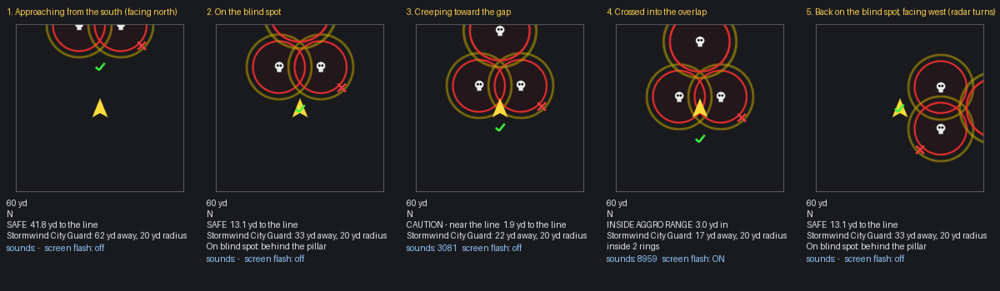

# Guard Aggro Watch

**A WoW addon for TBC Classic Anniversary (client 2.5.5 / 2.5.6). Version 1.1.0.**

A rogue's helper for hanging around enemy capitals. You mark where the guards stand. The addon draws each guard's
aggro range to scale around you and warns you before you cross the line. You can also record the blind spots where
you can gank without pulling guards.

*The radar while walking a rogue into a city gate (rendered by the test harness): approach, standing on a blind
spot, the caution zone, crossing the line (alarm and screen flash), and facing west so the radar turns with you.*

---

## Install

1. Get the `GuardAggroWatch` folder: use the ready-made `GuardAggroWatch-<version>.zip`, or on GitHub use **Code → Download ZIP** and take the folder out of it.
2. Put it in `World of Warcraft/_anniversary_/Interface/AddOns/` so you end up with
   `.../AddOns/GuardAggroWatch/GuardAggroWatch.toc`.
3. Restart the game or type `/reload`. Type `/gaw` in chat to see the help.

If the character screen says the addon is **out of date**, either tick *Load out of date AddOns*, or type
`/dump select(4, GetBuildInfo())` in game and put that number on the `## Interface:` line of `GuardAggroWatch.toc`.

## Quick start

1. **Map the guards.** On an alt of the guard's faction, walk up to each guard, target it and type `/gaw guard`.
   The addon uses the guard's level to work out its aggro range. Marks are shared by every character on your account.
2. **Lurk on your rogue.** The radar shows a red zone around each guard and a yellow caution ring outside it. Stay
   out of the red.
3. **Save your blind spots.** Stand in a good gank spot and type `/gaw safe behind the bank pillar`.
4. **Get pulled? It learns.** When a guard turns on you without you starting a fight, the addon marks the spot and
   shrinks or grows that guard's ring to the real distance.

---

## Core features

| Feature | What it does |
|---|---|
| **Radar HUD** | A top-down view of the ground around you, 60 yd by default. Red disc = a guard's aggro zone, yellow ring = caution buffer, skull = guard, green check = blind spot, red X = where you were pulled. It turns with your facing (or stays north-up) and can be moved and resized. |
| **Live status** | **SAFE / CAUTION / INSIDE AGGRO RANGE**, the exact yards to the line, which guard is closest and its radius, how many rings you are inside, and whether you are standing on a blind spot. |
| **Alerts** | A whisper chime when you enter the caution buffer. A raid-warning alarm and a pulsing red screen edge when you cross into aggro range. Each sound has its own throttle, so the alarm is never swallowed. |
| **Minimap rings** | Dotted aggro circles and mark icons on your minimap. Works with indoor or outdoor zoom (Ironforge and Undercity), a rotating minimap, and square minimap addons. |
| **World map overlay** | Shaded aggro zones and pins on the city, zone and continent maps. Hover a pin for its details (radius, notes, date). |
| **Aggro radius math** | About 20 yd against an equal-level guard, plus or minus 1 yd per level of difference, limited to 5-45 yd. It is recalculated as you level. You can override it per guard. |
| **Auto-learning** | Watches enemy nameplates for guards targeting you. It records a pull point, and for a clean pull (you hadn't attacked anyone) it calibrates that guard's ring to the real distance. |
| **Live guard sensor** | Counts the guards on your nameplates and, out of combat, estimates the closest one (within about 10 or 28 yd). |
| **Placing marks from a distance** | `ahead <yd>` drops a guard or blind-spot mark straight in front of you, for guards you can't walk up to. |
| **Account-wide data** | Map a city once on any character; every character sees it. |
| **Key bindings** | Mark guard, mark aggro line, mark blind spot, undo and toggle radar. Under *Key Bindings → Guard Aggro Watch*. |

---

## Commands

Type `/gaw` (or `/guardaggro`) on its own to see the help in game.

### Marking

| Command | What it does |
|---|---|
| `/gaw guard` | Mark a guard at your position. **Target the guard first** so its level sets the radius. |
| `/gaw guard <yd>` | Same, with a fixed radius (for example `/gaw guard 25`). |
| `/gaw guard ahead <yd> [radius]` | Mark a guard `<yd>` straight in front of you. |
| `/gaw safe [note]` | Mark a blind spot at your position, with an optional note. |
| `/gaw safe ahead <yd> [note]` | Mark a blind spot `<yd>` in front of you. |
| `/gaw edge` | Mark a point on the aggro line (where a guard noticed you). |

### Editing

| Command | What it does |
|---|---|
| `/gaw undo` | Remove the last mark you added. |
| `/gaw del` | Delete the nearest mark within 10 yd. |
| `/gaw setr <yd>` | Set the nearest guard's aggro radius. |
| `/gaw setr auto` | Go back to the radius worked out from level (also clears any learned value). |
| `/gaw clear` | Delete every mark on the current map (asks first). |
| `/gaw clear all` | Delete every mark everywhere (asks first). |
| `/gaw list` | Show mark counts per city. |

### Display

| Command | What it does |
|---|---|
| `/gaw radar` | Show or hide the radar. |
| `/gaw unlock` / `/gaw lock` | Let the radar be dragged / lock it in place (it ignores the mouse when locked). |
| `/gaw range <yd>` | Radar range (default 60). |
| `/gaw scale <n>` | Radar size (for example `1.3`). |
| `/gaw rotate` | Switch the radar between turning with you and north-up. |
| `/gaw minimap` | Minimap rings on/off. |
| `/gaw map` | World map overlay on/off. |

### Alerts and detection

| Command | What it does |
|---|---|
| `/gaw sound` | Alert sounds on/off. |
| `/gaw flash` | Red screen-edge pulse on/off. |
| `/gaw warn <yd>` | Width of the caution buffer (default 5). |
| `/gaw auto` | Auto-learning from guard pulls on/off. |
| `/gaw default <yd>` | Radius for guards marked without a known level (default 20). |
| `/gaw addname [text]` | Count NPCs whose name contains `text` (or your target's name) as guards. |

---

## Limits

These come from the game client, not from bugs:

- **No drawing on the actual ground.** Addons can't render in the 3D world, and TBC has no world markers. The radar,
  minimap and world map are the "ground markings".
- **No NPC positions.** Addons can't read where an NPC stands, so guards are marked by you. Rings around patrolling
  guards are approximate.
- **Stealth changes the numbers.** A stealthed rogue can get much closer than the ring. Once you open on someone you
  are visible and the full ring applies. Guards may also come running because your victim is fighting near them.
  Keep a buffer and let auto-learning calibrate the rings.
- **Positions don't work in instances** (dungeons, battlegrounds, arenas). The radar says so.
- **Guard detection by name is English-only.** On other game languages, use `/gaw addname <word>`.
- **The combat log is restricted** on this client, so "did you start the fight?" is judged from your own spell casts
  and auto-attack instead.

## Testing

`tests/guardaggrowatch/` (at the repo root) holds a test suite that runs the addon under Lua 5.1 against a strict
mock of the game client. Any widget method or global function missing from Blizzard's published UI source for
`classic_anniversary` raises an error. The suite also renders the radar image above. See the README in that folder
for how to run it.
