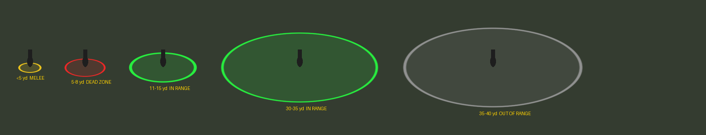

# Range Ring

A World of Warcraft **TBC Classic Anniversary** addon. A ring around your character grows and shrinks with the
distance to your hostile target, and its color shows the zone you're in:

| Color | Zone |
| --- | --- |
| Yellow | **Melee**: within melee reach |
| Red | **Dead zone**: hunters only, 5–8 yd, where neither melee nor Auto Shot works |
| Green | **In range**: up to 35 yd (Auto Shot's range for hunters) |
| Grey | **Out of range**: past 35 yd |
| White | The game gave no range answer |

The text under the ring shows the distance bracket, e.g. `11-15 yd  IN RANGE`.



## Install

Copy the `RangeRing` folder into `World of Warcraft/_anniversary_/Interface/AddOns/`, then `/reload`. Chat says
`RangeRing: v1.0.0 loaded`.

1. Type `/rr test`. For 8 seconds the ring grows from 0 to 42 yd through every color, no target needed.
2. Type `/rr unlock`, drag the ring onto your character's feet, then type `/rr lock`.

## How distance is measured

WoW doesn't tell addons where other units are, so the addon can't get an exact yard count. It combines yes/no range
checks into a "between X and Y yards" bracket:

- Your melee abilities (e.g. Raptor Strike, Sinister Strike, Claw), Auto Shot, and your class's ranged spells.
- Items the game can range-check without you owning them: 8, 10, 15, 20, 25, 30, 35 and 40 yd.
- The game's interact distances: about 10, 11 and 28 yd.

Out of combat that gives brackets roughly 5 yards wide. **In combat**, the game may block the item and interact
checks. If it does, the addon tells you once in chat and uses only your spells in combat from then on. For a hunter
that still covers every zone (melee, dead zone, in range, out), but the ring's size only changes when you cross a
zone boundary.

The ring is drawn on your screen, centred where you drag it. It isn't painted on the 3D ground; addons can't draw
there. `/rr flat` squashes it so it looks like it's lying on the floor.

## Commands (`/rr` or `/rangering`)

| Command | What it does |
| --- | --- |
| `/rr on`, `off`, `toggle` | Show or hide the ring |
| `/rr test` | 8 second preview through every zone |
| `/rr unlock` / `lock` | Drag the ring into place |
| `/rr size <1-15>` | Pixels per yard (default 5) |
| `/rr flat <0.2-1>` | How flat the ring looks (1 = circle, default 0.45) |
| `/rr alpha <0.1-1>` | Opacity |
| `/rr fill`, `label`, `guides` | Toggle the inner fill, the text, and faint fixed rings at 5, 8 and 35 yd |
| `/rr color melee\|dead\|ranged\|out <r g b>` | Zone colors, 0–1 or 0–255 |
| `/rr status`, `/rr reset` | Show settings and which checks are in use, or reset everything |

## Tests

```bash
pip install lupa
```

```bash
python3 tests/rangering/run.py
```

These run the addon under Lua 5.1 against the strict client mock in `tests/guardaggrowatch/`, with a simulated
target at set distances. A call to a widget method or global that isn't in Blizzard's 2.5.6 Anniversary UI source
fails the run.
